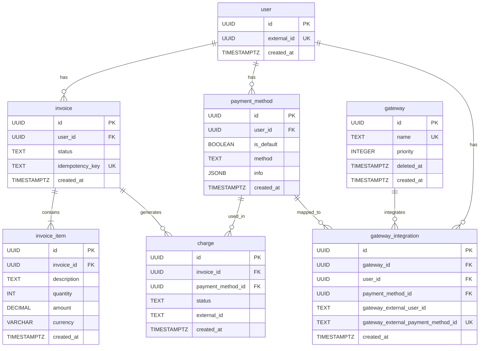

# auth-plus-billing

[](https://codecov.io/gh/auth-plus/auth-plus-billing)
[](https://snyk.io/test/github/auth-plus/auth-plus-billing)

Financial lifecycle, recurring billing, and payment reconciliation microservice for the `auth-plus` ecosystem.

---

## 1. Capabilities

- **Invoice Drafting & Aggregation:** Consolidates billable items into an ongoing `draft` invoice or creates a new one automatically.
- **Payment Method Management:** Registers Credit Card and Pix payment methods, links them to external payment gateways, and manages defaults.
- **Payment Gateway Integration:** Dynamic multi-gateway dispatch (currently integrated with the Stripe API for customer and payment intent creation).
- **Synchronous & Asynchronous Retries (Dunning / RCI):** CLI cronjob routine to reconcile and retry payments for invoices in `charged_with_error` or `pending` status.
- **Two-Tier Idempotency:** Cached responses in Redis/Valkey (`create_invoice:<key>`) coupled with a database `UNIQUE(idempotency_key)` constraint.
- **Event-Driven Synchronization:** Kafka consumer for customer creation (`USER_CREATED`) and telemetry.

---

## 2. Tech Stack

- **Language / Runtime:** Rust (2021 Edition), Tokio async runtime, Actix-web 4
- **Relational Database:** PostgreSQL 17.6 via SQLx (connection pool)
- **Cache & Deduplication:** Redis / Valkey 7-alpine (`redis` crate)
- **Messaging:** Apache Kafka via `rdkafka`
- **Observabilidade:** OpenTelemetry Rust SDK + Uptrace (`tracing-actix-web`)
- **Gateways:** Stripe REST API (`reqwest`)

---

## 3. Binaries & Executables (`src/bin`)

The repository provides three separate entry points:

| Binary | Source File | Description | Default Port |
| :--- | :--- | :--- | :--- |
| **`http`** | `src/bin/http.rs` | Actix-web REST API server with OTel tracing | `5002` |
| **`kafka`** | `src/bin/kafka.rs` | Continuous event consumer for Kafka topics | — |
| **`cronjob`** | `src/bin/cronjob.rs` | CLI runner for scheduled jobs (`clap` subcommands) | — |

---

## 4. Development & Setup

### 4.1. Requirements

- Docker & Docker Compose
- *Optional:* Rust toolchain (`cargo`, `clippy`, `rustfmt`) or [Nix](https://nixos.org/)

### 4.2. Docker & Makefile

```bash
# Start infrastructure (Postgres + Redis + API container) and run migrations
make dev

# Inside the dev container (or locally):
cargo run --bin http             # Start REST API server on port 5002
cargo run --bin kafka            # Start Kafka consumer
cargo run --bin cronjob -- rci   # Execute Retry Charging Invoices routine
cargo test -- --test-threads=1   # Run unit and integration tests

# Run linter and formatting
cargo fmt --check
cargo clippy --all-targets --all-features -- -D warnings

# Teardown containers and volumes
make infra/down
```

### 4.3. Nix Environment

```bash
nix develop    # Enter isolated dev shell with dependencies
nix build      # Build packages
```

---

## 5. Domain Architecture & Invoice Lifecycle

### 5.1. Hexagonal Architecture

The project strictly follows Ports & Adapters:
- `src/presentation/`: Driving adapters (HTTP routes, Kafka consumer, CLI cronjob).
- `src/core/usecase/`: Pure business rules (invoice creation, charging, status update).
- `src/core/usecase/driven/`: Driven ports (traits: `ReadingInvoice`, `CreatingCharge`, `GatewayAPI`...).
- `src/core/repository/` & `src/core/gateway/`: Concrete adapters (SQLx DAOs and Stripe client).

### 5.2. Invoice State Machine (`InvoiceStatus`)

```
                 ┌─────────┐
                 │  Draft  │
                 └────┬────┘
                      │
                      ▼
                ┌───────────┐
                │  Pending  │ ◄────────────────────────┐
                └─────┬─────┘                          │
                      │                                │
         ┌────────────┴────────────┐                   │
         ▼                         ▼                   │
  ┌──────────────┐      ┌────────────────────┐         │
  │     Paid     │      │  ChargedWithError  │ ────────┘ (cronjob rci / charge retry)
  └──┬───┬───┬───┘      └─────────┬──────────┘
     │   │   │                    │
     │   │   │                    ▼
     │   │   │          ┌────────────────────┐
     │   │   │          │   Uncollectible    │
     │   │   │          └────────────────────┘
     │   │   │
     │   │   └──────────────────────┐
     │   ▼                          ▼
     │ ┌────────────────┐ ┌───────────────────┐
     │ │    Refunded    │ │     InProtest     │
     │ └────────────────┘ └─────────┬─────────┘
     ▼                              │
┌──────────────┐                    ▼
│  Cancelled   │          ┌───────────────────┐
└──────────────┘          │    Chargeback     │
                          └───────────────────┘
```

#### State Transition Rules (`InvoiceUpdateUsecase`):
- `Draft` $\rightarrow$ `Pending`
- `Pending` $\rightarrow$ `Paid` or `ChargedWithError`
- `ChargedWithError` $\rightarrow$ `Paid` or `Uncollectible`
- `Paid` $\rightarrow$ `Cancelled`, `Refunded` or `InProtest`
- `InProtest` $\rightarrow$ `Chargeback`

### 5.3. Entity-Relationship Model



---

## 6. HTTP API Overview

| Method | Endpoint | Description |
| :--- | :--- | :--- |
| `GET` | `/health` | Health and liveness probe (returns `200 OK`) |
| `POST` | `/user` | Creates user and synchronizes customer with the payment gateway |
| `POST` | `/payment_method` | Registers a credit card or pix method and updates gateway bindings |
| `POST` | `/invoice` | Creates an invoice or appends items to an existing `draft` invoice |
| `GET` | `/invoice/{user_id}` | Retrieves all invoices for the given external user UUID |
| `PATCH` | `/invoice` | Transitions invoice status according to state machine rules |
| `POST` | `/charge` | Executes an immediate debit charge against the user's default payment method |

> **Note on `/invoice`:** Payload requires `external_user_id`, `itens` (array), and `idempotency_key`.

---

## 7. Kafka Consumer

The Kafka consumer (`cargo run --bin kafka`) subscribes to:
- **`USER_CREATED`:** Consumes `{ external_id, name, email }`, provisions a Stripe customer (`create_customer`), and creates `user` + `gateway_integration` records locally.
- **Stubs:** `2FA_EMAIL_CREATED`, `2FA_PHONE_CREATED`, `2FA_EMAIL_SENT`, `2FA_PHONE_SENT`, `ORGANIZATION_CREATED` (registered for future event-based metered billing).

---

## 8. Scheduled Routines (Cronjob)

The CLI utility runs maintenance and retry logic:

```bash
# Retry Charging Invoices: queries all 'charged_with_error' or 'pending' invoices and retries charge
cargo run --bin cronjob -- rci
```

---

## 9. Roadmap

- [ ] Inbound Payment Gateway Webhooks (Stripe event reconciliation)
- [ ] Additional Gateways (Vindi, Iugu, PagSeguro, Pix PSP direct integrations)
- [ ] Metered consumption billing handlers for 2FA / Organization events
- [ ] GraphQL query API via Juniper or Async-GraphQL
